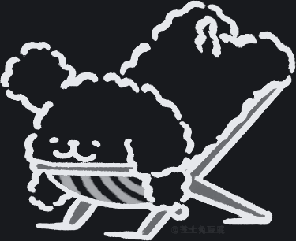

# deepseek-pet-balance

A desktop pet for **DeepSeek Harness (DSH)** that floats in the window overlay and shows your
account's **recharge balance** and **bonus balance** in real time.

The pet is drawn as pure line art: the artwork ships as a coverage mask, so its colour follows the
Harness theme and there is no white plate behind it on a dark page.

| Dark theme | Light theme |
| --- | --- |
|  |  |

## Features

- **Live balances** — reads the same Host service the *Settings → Account* page uses, so the numbers
  always match what the app shows. Refreshes on a timer, on window focus, and on demand.
- **Click to refresh** — a single click on the pet re-reads the balances; a subtle 4% pulse is the
  only feedback. Dragging the pet moves it, and the position is remembered.
- **Theme-aware line art** — one asset, legible on light and dark themes, with no background plate.
- **No Host logic** — balances arrive through the client-facing account Remote namespace, so the
  Host half is an empty plugin row.

## Requirements

- DeepSeek Harness with the Web desktop profile (`dsh` on `PATH`).
- A signed-in DeepSeek account. Without one the bubble reads `未登录`.

## Install

Clone this repository somewhere permanent, then install the package directory as a bundle:

```sh
git clone https://github.com/selvinchen97-lab/deepseek-pet.git
cd deepseek-pet
dsh plugin --profile desktop add .
```

`dsh plugin add` links the checkout and appends the bundle to the profile's `dsh.profile.bundles`,
so no manual edit of `package.json` or `cordis.patch.yml` is needed. Verify the layer without
booting:

```sh
dsh --profile desktop --dump-config   # shows a "# == @local/dsh-pet-balance" layer
```

To remove it again:

```sh
dsh plugin --profile desktop remove @local/dsh-pet-balance
```

`client.js` is committed already built, so installing needs no toolchain and no build permission.

## Use

| Action | Effect |
| --- | --- |
| **Click the pet** | Re-read the balances immediately |
| Drag the pet | Move it; the position is saved in `localStorage` |
| Double-click the bubble | Collapse / expand the bubble |

Balances also refresh every 10 minutes and whenever the window regains focus.

The labels are `充值` (recharge) and `赠金` (bonus), each formatted to two decimals with its
currency symbol. A wallet whose balance is zero is omitted, and an unparsable amount renders as `—`.

## How it works

The plugin is one bundle with two halves:

| Half | File | Role |
| --- | --- | --- |
| Host | `index.js` | An activatable row with no logic of its own. |
| Client | `client.js` | Registers one component in the frame-wide `shell.overlay` slot. |

Balances come from the account Remote namespace, which the API remotes assembly already mounts:

```js
const result = await ctx.remote.account.getBalance({ version, locale, timezoneOffsetSeconds })
// result.ok === true → result.value.value        : recharge wallets
//                      result.value.bonusWallets : bonus wallets
```

The client half declares `inject: ['slots', 'remote', 'remote.account']`, captures `ctx.remote` in
its `apply` closure, and hands it to the component. `shell.overlay` is click-through, so the root is
`pointer-events: none` and only the pet and the bubble opt back in.

## Artwork

`pet-line.png` is a **coverage mask**: white RGB, alpha carrying the stroke coverage. Colour is
applied by CSS, so the same asset works on both themes:

```css
.dshp-pet {
  background-color: var(--dsw-alias-label-primary); /* line colour follows the theme */
  mask-image: var(--dshp-art);
}
```

`tools/line.py` generates the mask from the original artwork. It needs no flood fill: the strokes
are dark and the page is light, so luminance separates them, and each pixel's alpha rises as its
luminance falls — which preserves the antialiased side of the ink while dropping the white page,
the cream floor and every fill colour to fully transparent.

`tools/cut.py` is the alternative route kept in the repository: it keeps the fills and removes only
the white page. That route is harder than it looks, and the script records why:

1. the page and the bunny's own fill are the same pure white, so no colour threshold separates them;
2. the outline has a gap, so a flood fill of the page leaks into the body — dilating the ink by 3px
   seals it (2px still leaks), while a morphological closing does not seal it at any useful radius;
3. once the leak is stopped, several blank areas remain enclosed by the outline, so the only correct
   test for background is **reachability**: a bright pixel is background only when it can reach the
   frame border through other bright pixels.

`cut.py` asserts after every run that the body sample is not classified as page and that the result
has no enclosed transparent pixels, so it fails loudly instead of quietly erasing the body.

## Development

Everything is plain JavaScript; there is no compiler and no bundler.

```
ui-template.mjs   readable source of the client half, with a __PET_DATA_URI__ placeholder
build.mjs         inlines pet-line.png into the template and writes client.js
client.js         generated — do not edit by hand
```

Rebuild after changing the template or the artwork:

```sh
npm run build                 # node build.mjs
node tools/verify-asset.mjs   # confirms client.js embeds the current pet-line.png
```

Regenerate the artwork (needs Python with Pillow):

```sh
python tools/line.py pet-source.png pet-line.png
```

### Reloading a running Harness

A rebuilt `client.js` is not swapped into an already-loaded page. Toggle the bundle off and on to
make the browser fetch the new revision:

```sh
dsh plugin --profile desktop remove @local/dsh-pet-balance
dsh plugin --profile desktop add .
```

If the appearance still does not change, restart DeepSeek Harness: the desktop client keeps its
first bundle for the session.

## Plugin layout

| File | Purpose |
| --- | --- |
| `package.json` | Bundle manifest: `dsh.bundle.patch` and the `dsh.client` declaration |
| `cordis.patch.yml` | Inserts the `pet-balance` row into the composed tree |
| `index.js` | Host half |
| `ui-template.mjs` | Client half, as readable source |
| `build.mjs` | Generates `client.js` |
| `client.js` | Generated browser bundle |
| `pet-line.png` | Line-art coverage mask (white RGB, coverage in alpha) |
| `pet-source.png` | Original artwork, kept so the mask can be regenerated |
| `pet-source.png` | Original artwork, kept for regeneration |
| `icon.svg`, `locale/*.json` | Plugin manager icon, title and description |
| `tools/line.py`, `tools/cut.py` | Artwork tooling |
| `tools/verify-asset.mjs` | Asset/build consistency check |
| `docs/preview-*.png` | README previews |

## License

MIT — see [LICENSE](LICENSE).
